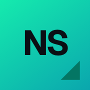
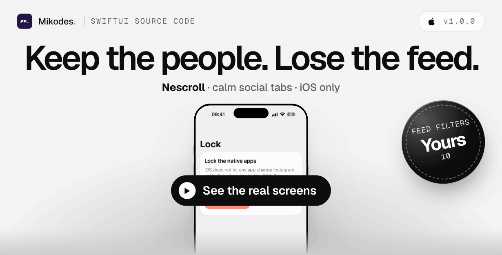
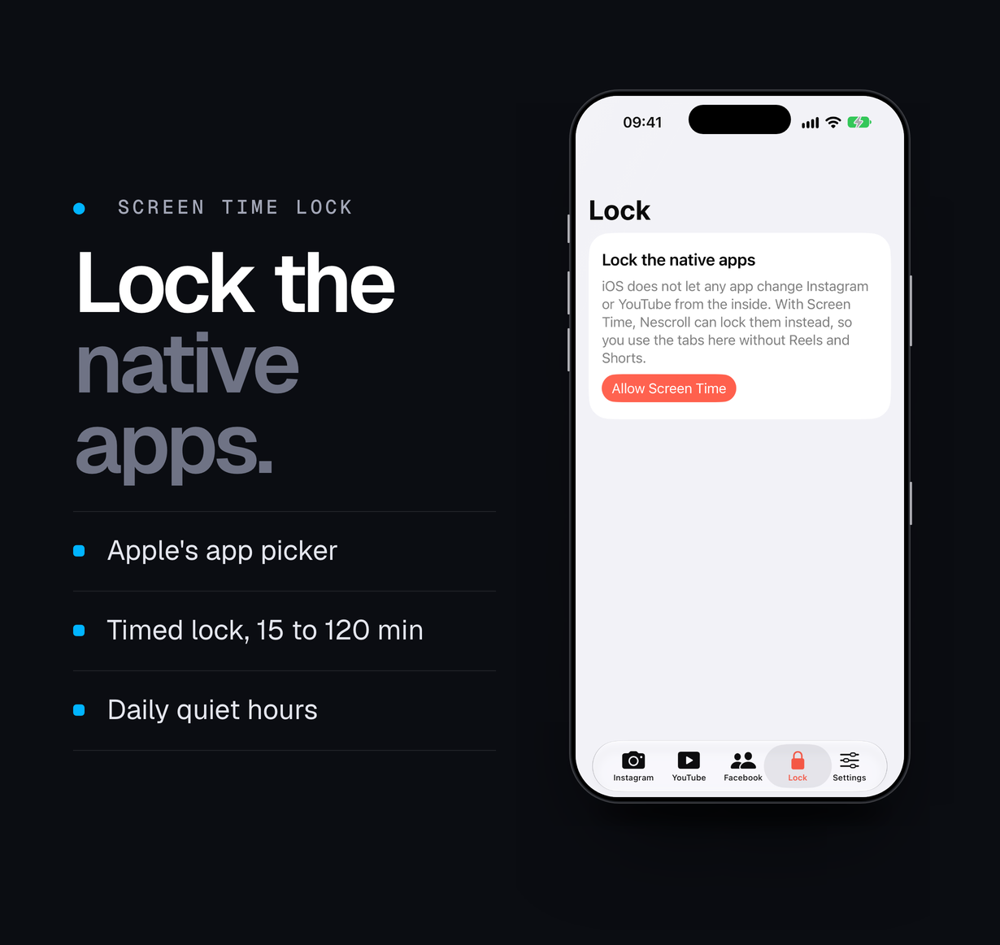
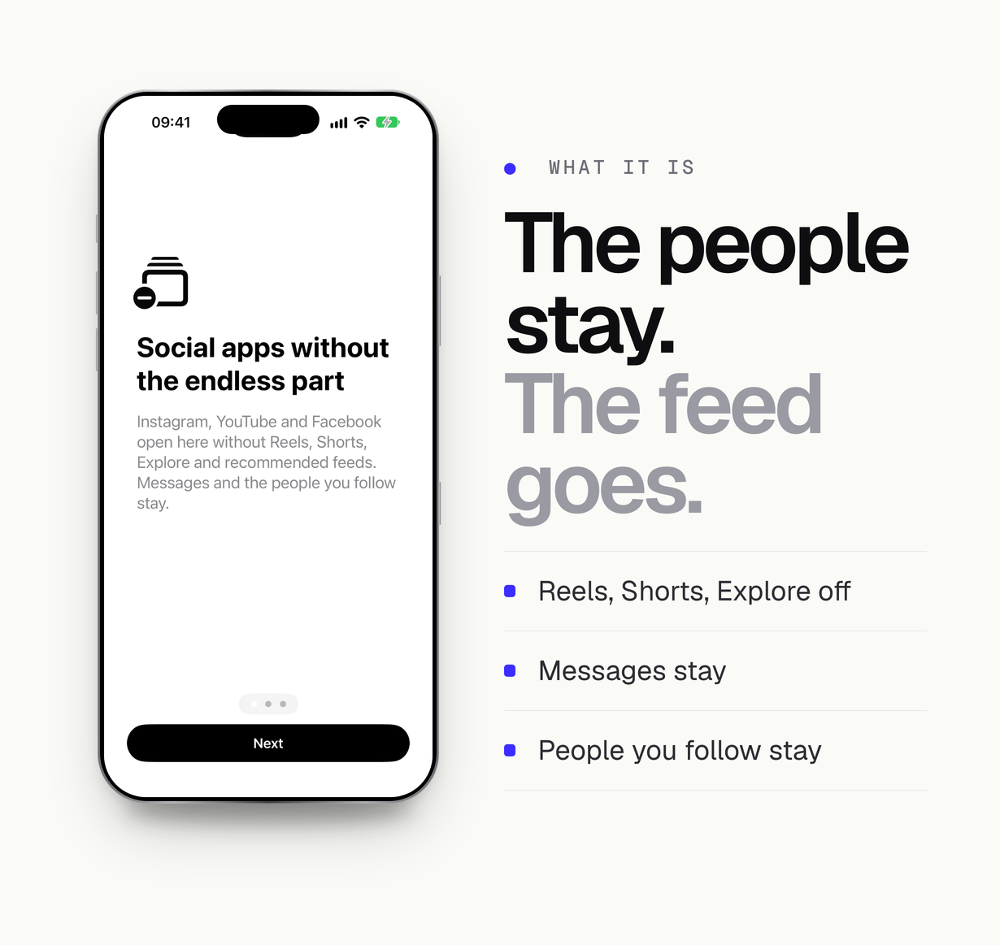
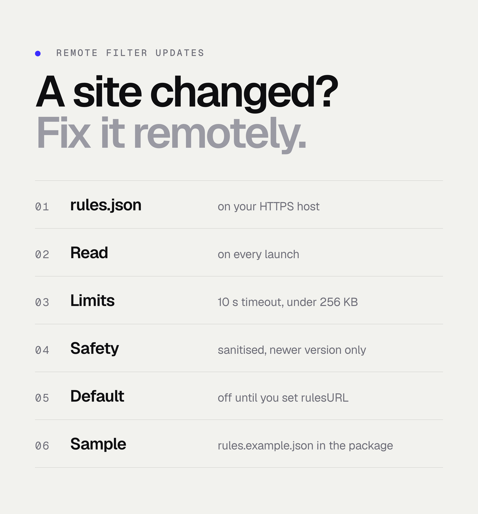
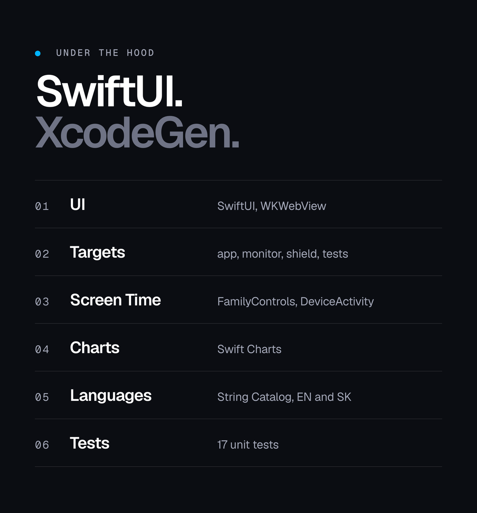

  

<h1 align="center">Nescroll</h1>

  <b>Social browser without endless feeds, with a screen-time lock (SwiftUI, iOS).</b>

  <a href="https://nescroll.mikodes.com/docs/"><b>Docs</b></a> ·
  <a href="https://nescroll.mikodes.com/"><b>Website</b></a> ·
  <a href="https://store.mikodes.com/p/nescroll/"><b>Get the full source code</b></a>

  
  

  

> **This repository is a showcase.** It holds screenshots, documentation pointers and a real excerpt
> from the code. The full application is sold as source code at
> **[store.mikodes.com/p/nescroll](https://store.mikodes.com/p/nescroll/)**: one payment, instant ZIP download, free setup help.

---

## What it is

A native iPhone and iPad app that opens social sites in calm browser tabs with the endless feeds removed, plus daily limits and a lock that keeps scrolling in check.

## Screens

 

 

## Features

- **iOS only: native SwiftUI app for iPhone and iPad, no Android version**
- **Three social sites in calm browser tabs**
- **10 switchable feed filters**
- **Redirect, selector and label filter engine**
- **Autoplay off and Up next removed**
- **Screen Time lock of native apps**
- **Timed lock**
- **Daily quiet hours**
- **DeviceActivity monitor extension**
- **Custom shield screen**
- **Three-screen onboarding**
- **7-day statistics chart**

## A look at the code

**Safe remote filter updates**: [`snippets/RemoteRules.swift`](snippets/RemoteRules.swift). When a social site changes its pages, the app can pick up new filter rules from a plain JSON file. Each rule is validated on the device (length limits, no CSS blocks, only same-site redirects, valid regexes), so a bad file can never break the app.

## Requirements (full version)

- iOS only, no Android version: iPhone and iPad with iOS 17 or newer
- A Mac with Xcode 26 or newer
- Apple Developer Program membership
- A real iPhone with iOS 17 or newer for the Screen Time lock
- Apple's Family Controls
- Optional: XcodeGen 2.x

Not included: Apple Developer Program membership; Apple Family Controls; App Store publishing and review outcome; Hosting for the optional rules.json; Any affiliation with or permission from Instagram, Facebook, Meta, YouTube or Google.

## Get the full source code

  

One payment, full licence, instant ZIP download and free setup help.
Questions: [mikodes.com/support](https://mikodes.com/support).

---

  Made by <a href="https://mikodes.com"><b>MIKODES</b></a> · <a href="https://github.com/Mikodesteam">more projects</a>

