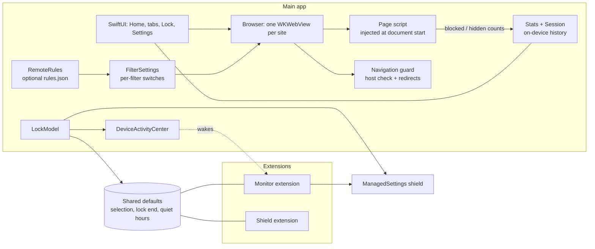

# How Nescroll works

An engineering write-up of Nescroll, a native SwiftUI app for iPhone and iPad that gives social sites a calmer front door: Reels, Shorts and "suggested" feeds are taken out of the page, and Screen Time can lock the native apps. It describes what the code does and why. The full source is sold separately (link at the end); only a few excerpts are public.

## Reading order

If you only have five minutes, read "Key engineering decisions" and then the three excerpts in [`../snippets/`](../snippets/). None of them is a working module on its own.

## The problem and who it is for

Short-video feeds are designed to keep you scrolling, and the apps give you no switch to turn them off. Nescroll opens the same sites in browser tabs that cut those feeds out while leaving messages, subscriptions and search usable, and it can put a Screen Time shield over the original apps. It is for people who want to use these services on purpose, and for developers or agencies who want a branded "calm social" app they can ship under their own name.

Design constraints that shape the code: iOS only, no server, no accounts, no analytics, and filters that keep working after a site changes its markup.

## Architecture

The app is three processes that share almost nothing. The main app hosts one web view per site. Two small iOS extensions (a device-activity monitor and a shield configuration provider) run in their own processes and talk to the app only through a shared settings container.

Components, by folder:

- `Platform.swift` describes each wrapped site: home URL, hosts that may open inside the tab, hosts redirects apply to, the selector for one feed item, and a list of `Filter` values.
- `Browser.swift` owns the `WKWebView`, builds the page-script configuration from the enabled filters, and is the navigation delegate.
- `Resources/page.js` is the script that runs inside the page: redirects, hidden selectors, hidden labels.
- `RemoteRules.swift` optionally fetches a JSON file of filter fixes.
- `Lock/`, `Shared/`, `Monitor/` and `Shield/` implement the Screen Time features.
- `Settings.swift` and `Session.swift` keep per-day counters and short, time-boxed visits on the device.
- `AppConfig.swift` is the single place a buyer edits to rebrand: name, support and privacy links, the optional rules URL, and which sites get a tab.

## One flow, step by step: tapping a feed link that would have been a Reel

1. **Load.** A tab's web view loads the site. A user-content script is injected at document start in the main frame only, with the enabled filters serialised into it as JSON.
2. **Navigation guard.** Before any main-frame navigation, the delegate checks the scheme: only `http` and `https` pass (plus `about`, `blob` and `data`); everything else is cancelled. Then it checks the host: a link that leaves the site's allowed host list is cancelled and opened in a separate Safari sheet instead of inside the tab.
3. **Redirect in native code.** If the URL belongs to a host the filters cover, the path and query are tested against each enabled redirect's regular expression. A match rewrites only the path and query (so the reels listing becomes the inbox, or a short opens as a normal watch page) and the original load is cancelled.
4. **Redirect in the page.** The sites are single-page apps, so a click may change the URL without a navigation. The page script therefore wraps `pushState` and `replaceState`, listens for `popstate`, and polls on a short timer, applying the same redirect rules in JavaScript with `location.replace`.
5. **Hide by selector.** The script adds one style element that sets `display: none !important` for every selector the enabled filters list. It also stamps the current path on the document element, so a selector can be scoped to one page.
6. **Hide by label.** For text such as "Suggested for you", a tree walker looks for text nodes that exactly match a known label, finds the enclosing feed item, and hides it only if it passes a safety check (see the excerpt [`../snippets/page_label_sweep.js`](../snippets/page_label_sweep.js)). A mutation observer re-runs the sweep, debounced, as the feed grows.
7. **Count.** The script posts how many items it blocked or hid. The native side adds the number to a 30-day history kept in local defaults, which feeds the 7-day chart.

The same regular expression has to behave identically in Swift's `NSRegularExpression` and in JavaScript, so redirect patterns are written in the subset both engines read the same way, and unit tests exercise the redirect rules on the native side.

## Key engineering decisions

### 1. Rules as data, with three primitives

*Chosen:* every filter is data: redirects (regex to path), CSS selectors, and exact label texts. There is no per-filter script. *Alternative:* a custom code path per site and feature. *Why:* social sites change their markup often. With three primitives, a fix is one line in a list, the same code path is tested for every filter, and the user can switch each filter off individually in Settings. All filters start on.

### 2. Two layers of redirect

*Chosen:* the same rules run natively (in the navigation delegate) and in the page. *Alternative:* page script only. *Why:* the native layer stops a full navigation before it renders; the page layer catches single-page-app route changes that never trigger a navigation. Either alone leaves a visible gap.

### 3. Remote rule updates that cannot hurt the app

*Chosen:* an optional `rules.json` the operator hosts. It is fetched once per launch over https with a 10-second timeout, a size limit under 256 KB and a version number; an older file never replaces a newer one, and the last good copy stays when offline. Each entry is sanitised on the device (see [`../snippets/RemoteRules.swift`](../snippets/RemoteRules.swift)). *Alternative:* ship every fix as an App Store release, or accept arbitrary rules from a server. *Why:* review cycles are too slow for a selector that broke today, but a remote file must not be able to inject styles, redirect off-site or crash the app, so the device validates everything.

### 4. Screen Time through shared state and an extension

*Chosen:* the lock state (chosen apps, lock end time, quiet window) lives in a shared settings container. A monitor extension is woken by the system when a timed lock or quiet window starts or ends, even if the app was force-quit or the phone restarted, and it only re-evaluates the shared state and raises or lowers the shield. *Alternative:* timers inside the app. *Why:* an app cannot be trusted to be running at the moment a lock should end. If the system rejects the background timer, the app says so and falls back to ending the lock the next time it opens.

### 5. Window math as a pure function

*Chosen:* quiet hours are stored as minutes after midnight and tested with one small function that handles windows crossing midnight (see [`../snippets/lock_quiet_hours.swift`](../snippets/lock_quiet_hours.swift)). The system refuses windows under 15 minutes, so lock lengths are clamped to a minimum of 15 minutes and a maximum of 24 hours. *Alternative:* date arithmetic spread across views. *Why:* the 22:00 to 07:00 case is where this kind of code usually breaks, and a pure function can be unit tested without a device.

### 6. A sign of safe failure: a wrong label only means no match

Hiding is conservative. A label that does not exist on a page matches nothing; a selector that matches nothing hides nothing. The riskiest operation (hide by label) climbs from the text to a feed item, then refuses to hide anything very tall, or containing navigation, a header, a text field or an editable region.

## Security and privacy measures that exist in the code

- **No server, no accounts, no analytics.** The only network call besides the wrapped sites is the optional rules file, a plain GET with no user data.
- **Scheme and host allow-lists** in the navigation delegate; off-site links open in a separate Safari sheet, and links that ask for a new window are handled the same way.
- **Remote rules are sanitised on the device:** length limits on selectors, labels and patterns; selectors containing CSS block characters are dropped; redirect targets must be same-site paths (start with a slash, no double slash); regular expressions must compile; list sizes are capped; https only.
- **Privacy manifests** are included in the app and in both extensions, declaring no tracking and no collected data.
- **On-device history only.** Daily counters and session minutes are kept in local defaults, trimmed to 30 days.
- **Inspectable web view only in debug builds,** so Safari's web inspector can be used while fixing a filter but is off in release.
- **A "sign out of every site" action** removes the web view's stored website data after a confirmation.
- **Weak message handler** so the web view's script bridge does not retain the browser object.
- **Tests:** 17 unit tests cover redirects, host rules, the page-script configuration, built-in filter ids, label length limits, localisation, lock windows, history and rule sanitising, including that the shipped example rules file is accepted unchanged.

## Details worth a closer look

### The ten built-in filters

| Site | Filters (each switchable) |
|---|---|
| Instagram | Reels, Explore, Suggested posts |
| YouTube | Shorts, Home feed, Up next |
| Facebook | Reels, Video tab, Suggested posts, Marketplace |

Redirects send you somewhere calmer rather than to an error: the reels listing goes to the inbox, the Shorts tab goes to subscriptions, the recommended home feed goes to subscriptions. A single item someone sends you still opens, as a normal page (a short becomes an ordinary video with no swipe to the next).

### Host matching is suffix matching with a dot

A host is "inside" a site if it equals an allowed host or ends with `"." + host`. That is why a lookalike such as a host that merely ends in the same letters does not pass: there is a unit test for exactly that case. Sign-in flows work because each site's list includes the hosts it sends you through.

### Media and sessions

Media playback requires a user action (autoplay is off for every tab), and the web view identifies itself as Safari because the sites' sign-in pages accept that. A "session" is an intent picked on Home (reply to messages, watch subscriptions) plus a time budget of 5, 10, 15 or 30 minutes; a ticker ends it and shows an end screen, with a five-minute extension on offer. Minutes per day are accumulated from session start and stop times and stay on the device.

### The shield screen

When a locked app is opened, the shield extension supplies the replacement screen: a title, a subtitle that says how many minutes of the lock remain (or that quiet hours are on) and a count of attempts today. The count is kept per day in the shared state, so the shield and the Stats card read the same number.

### Localisation

The interface base language is English with a Slovak translation, and the filter labels include Slovak and Czech texts for the "suggested" and "reels" shelves. These local labels are documented as unverified on live accounts; because a label that does not match simply hides nothing, a wrong text is harmless, which is why they can be shipped and corrected later.

## How you would build something like this

1. **Decide what "calm" means as data.** List what you want gone (a tab, a shelf, a suggestion label) and express each as a redirect, a selector or a label. Resist code per site.
2. **Wrap each site in its own web view** and keep it alive across tab switches so each stays where the user left it. Inject your script at document start, in the main frame only.
3. **Guard navigation first.** Allow-list schemes and hosts before writing any filter, so sign-in flows still work and everything else leaves the tab.
4. **Make the page script resilient to single-page apps:** hook history changes, debounce a mutation observer, and keep the "is it safe to hide this" check stricter than the "does it match" check.
5. **Add a kill switch per filter** and a counter, so users see value and can undo any rule that misfires.
6. **Add Screen Time last,** and design it around the fact that your app may not be running: shared state, a monitor extension, and a shield extension that only reads that state.
7. **Treat remote updates as untrusted input.** Version them, size-limit them, validate each entry, and keep the last good copy.
8. **Test the boring parts:** midnight-crossing windows, regex parity between native and page, and a fixture of the remote file.

## What this repository does not contain

The app target, both extensions, the page script in full, the localisation catalogue, the unit tests and the buyer documentation are not published here. This write-up explains how they fit together.

## Deployment and customization

- Native SwiftUI for iPhone and iPad, iOS 17 or newer. The project is generated from a small project file, so bundle identifiers, team and the shared container name are changed in one place.
- Rebranding is mostly one configuration file (name, privacy and support links, which sites get a tab) plus the app icon. The interface ships in English and Slovak.
- The Screen Time lock needs a real iPhone and Apple's Family Controls entitlement approval for the app and both extensions before TestFlight or the App Store; the buyer uses their own developer account.
- Filters can be updated without a release by hosting a rules file and setting its address in the configuration (off by default).

Full source code, docs and setup help: https://store.mikodes.com/p/nescroll/
